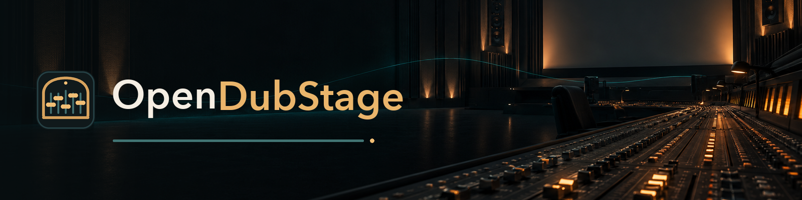

<p align="center"></p>

# OpenDubStage

[](https://github.com/gothicpixie/opendubstage/actions/workflows/ci.yml)
[](LICENSE)


**Open tools for documentary and film sound post-production.** These are offline, scriptable, testable versions of the
moves a dialogue editor and a re-recording mixer make every day: spectral repair, EQ matching between voices,
frequency-aware music ducking, J- and L-cuts, a broadcast-style QC pass, and restrained sound for still photographs.

Each tool is a small Python module that you can read in one sitting. It has a documented method, defaults with the
reasoning behind them, synthetic tests, and a command line. The audio cores need only **numpy, scipy and soundfile**.
Model-based backends are optional extras, and the test suite never downloads a model.

> **Status: alpha (0.1.0.dev0).** Every tool runs and is tested on synthetic signals. Interfaces may still change before 1.0.

## Contents

| Package | Tool | What it does |
|---|---|---|
| `opendubstage.restore` | `specrepair` | RX-style spectral repair. *Replace* fills a cough, throat clear or handling noise in a pause with EQ- and level-matched room tone from the same recording. *Attenuate* pulls an event that overlaps speech down to the spectral context. LF thumps (20–150 Hz) are detected and attenuated. The output is bit-exact outside the reported regions. |
| | `memofix` | Removes rumble from a voice memo recorded in a car (or a boomy room). It learns a noise profile from the gaps between words, subtracts below 400 Hz only, then applies a gentle, clamped EQ toward the international long-term average speech spectrum. Nothing is resynthesised. |
| `opendubstage.match` | `ltasmatch` | Dialogue EQ match. It compares long-term average spectra on speech frames, then fits a smoothed, gain-limited set of peaking bands. The output is a plain `ffmpeg` `equalizer` chain, plus an early-reflections helper for putting a dry voice in a small room. |
| `opendubstage.mix` | `carve` | Speech-keyed dynamic EQ: the music's 1–4 kHz band dips while dialogue is active. It also provides *posts*, where music comes up in the gaps between lines and dips just before the next word, and *phrase-safe* music outs on a section, phrase or downbeat. |
| | `transitions` | A cue-sheet pass at chapter boundaries. It adds ambience pre-laps (J-cuts), tails (L-cuts) and equal-power music crossfades, and puts a short ambience gap between two foreground songs. It never moves a sync point, touches dialogue or extends a cue past its source. |
| `opendubstage.qc` | `qc` | Public-radio-style mix QC: integrated loudness (BS.1770-4 gating), true peak, LRA, dead air, clicks at cue edges, level jumps between voices, music/ambience masking of speech in the presence band, hard stops and tonal balance per voice class. Blocking and advisory checks are kept separate. |
| `opendubstage.foley` | `foley` | Sound for stills and archival footage. It analyses each picture, proposes sounds, then applies documentary placement rules (levels relative to dialogue, density caps, never on the cut, key-line protection, no-sound classes). The output is an auditable cue sheet. Library and local-model backends are pluggable. See [docs/foley.md](docs/foley.md). |
| `skills/` | | Agent skills for documentary sound design; see [skills/README.md](skills/README.md). |

The planned tools (dialogue leveller, room-tone synthesis, de-reverb, a true-peak limiter helper and an MLX VoxCPM LoRA
training port) are listed in [ROADMAP.md](ROADMAP.md).

## Install

```bash
pip install -e ".[dev]"                 # from a clone; Python >= 3.10
# or, with uv:
uv venv .venv --python 3.12 && uv pip install --python .venv/bin/python -e ".[dev]"
```

`ffmpeg` and `ffprobe` on `PATH` are needed for some paths: decoding non-WAV input in `ltasmatch`, source-length
probing in `transitions`, and rendering in `foley`. The rest is pure Python.

Optional extras:

| Extra | Pulls in | For |
|---|---|---|
| `dev` | pytest, hypothesis | the test suite |
| `woosh` | torch, torchaudio, torchvision, Pillow | the local generative foley backend (installed from source; weights are **CC-BY-NC 4.0**, see [NOTICE](NOTICE)) |
| `vision` | pyobjc-framework-Vision (macOS) | Apple Vision scene labels for foley |

## Command line

```text
opendubstage <tool> [args...]          # opendubstage --help lists the tools

opendubstage specrepair in.wav out.wav --events events.json --protected words.json --thumps --report rep.json
opendubstage memofix memo.wav memo_fixed.wav --words words.json --strength 0.6
opendubstage ltasmatch reference_voice.wav other_voice.wav --gmax 6 --protect-below 160
opendubstage carve music.wav dialogue.wav music_carved.wav --cut-db -6
opendubstage transitions cues.json chapters.json cues_out.json --probe-cache durations.json
opendubstage qc mix.wav --cues cues.json --md qc.md --json qc.json
opendubstage foley plan examples/foley/public_domain/sequence.json -o cues.json
```

Interval files (`--events`, `--protected`, `--words`) accept `[[start, end], ...]` or a list of word objects with
`t`/`e` or `start`/`end` keys (most ASR word-timing exports). Each tool's module docstring documents its method, schema
and defaults. `python -m opendubstage.<package>.<tool> --help` runs any tool on its own.

## Working practice the defaults encode

These are general documentary and public-radio practices. They come from published delivery specs, standards and
practitioner writing (see [Sources](#sources)), and every number is a keyword argument you can change.

**Dialogue first**
- Anchor the mix on dialogue loudness, not on the programme (about −24 LUFS for public-radio delivery, ±2 LU; dialogue-gated
  specs for streaming). Use one linear gain per voice, with a limiter as the only non-linear stage on the master. Report
  LRA; don't clamp it.
- Edit in whole sentences: in on a sentence start, out on a real full stop, with air on both sides and the fade inside the air.
- When voices from different sources must sit together, match the better source *down* toward the worse one, not the
  other way round. Match with a smoothed, gain-limited EQ, because a fine-resolution match copies formants and sounds phasey.
- Remove events, not character. Coughs, throat clears and thumps go; laughs, sighs and the room stay, because they are
  content. Clean lightly and judge by blind A/B, never by a metric alone.
- Fill every hole with room tone taken from the same recording, spliced with short equal-power crossfades. Don't stack
  tone under speech.

**Music around speech**
- Duck by frequency as well as by depth. A moderate full-band duck plus a few-dB dip at 1–4 kHz while someone speaks
  buys more intelligibility than a deeper duck, and it doesn't pump. That band is where the speech intelligibility
  index weights peak.
- Use posts, not interludes. Music comes up in the clear between lines (gaps of about 2.5 s or more) and drops just
  before the next word. A post shorter than about 1.5 s reads as pumping.
- Music enters on the music and leaves on the music: on a downbeat or section start, never fading up from nothing and
  never in the moment before a first word. It exits on a phrase end with a fade of about a bar.
- Nothing sung under speech. A vocal track over dialogue is swapped for an instrumental or not used there.
- Stories need room to breathe. Bound how long one cue runs under continuous speech, and leave stretches with no
  music at all.

**Transitions and beds**
- Never dead air. A scene bed runs under narration roughly 15 LU below dialogue, so a pause is a place, not a dropout.
  Keep designed silences rare and choose them by hand.
- Pre-lap the incoming scene's ambience (J-cut) and let the outgoing scene's sound tail under the next (L-cut). Nothing
  stops dead on a boundary.
- Live music isn't speech. Keep it out of the speech chain (de-esser, compressor, voice EQ) and out of the duck sidechain.

**Sound for stills**
- Only sources visible in the frame get a spot effect. Use at most one per still, place it off the cut, and keep it out of
  key lines and the half-second before a narration onset.
- Distance is the dial. A spot must never sound nearer than the narrator. Band-limit and "worldize" effects to the
  scene and era, and prefer distant textures to close hits.
- Portraits, close-ups, details and technically weak pictures get the bed only. Silence is the default.

**QC**
- Check loudness and true peak *after* the delivery codec. Check dead air, clicks at every edit, voice-to-voice level
  jumps and masking of speech in the presence band. Listen on the playback devices the audience will use
  (a TV, a laptop, a phone).
- Test intelligibility at low volume: if you turn the listening level down halfway, can you still understand every word?

## Development

```bash
make verify          # byte-compile + full pytest suite; fast, offline, deterministic
```

CI runs the same target on Linux and macOS for Python 3.10, 3.11, 3.12 and 3.13, with `ffmpeg` installed and no model
downloads. All test signals are synthetic. The only media in the repo are five public-domain photographs, listed in
[examples/foley/public_domain/SOURCES.md](examples/foley/public_domain/SOURCES.md). See [CONTRIBUTING.md](CONTRIBUTING.md).

## Sources

The defaults cite their sources in each module's docstring and in [docs/foley-rules.md](docs/foley-rules.md). The main
references are:

- ITU-R BS.1770-4 (loudness and true peak); EBU R 128 and Tech 3342 (loudness range).
- PRSS/NPR distribution loudness (−24 LUFS ±2, −2 dBTP); streaming dialogue-gated delivery specs; Apple Podcasts audio
  requirements.
- ANSI S3.5-1997, Speech Intelligibility Index (band-importance weights).
- Torcoli et al., JAES 2019, on the loudness difference between commentary and background preferred by listeners
  (at least 10 LU over music and 15 LU over ambience).
- Byrne et al., JASA 1994, "An international comparison of long-term average speech spectra".
- Public-radio training material on scoring, posts and mixing checklists (NPR Training; Transom.org).

## Licence

Apache-2.0; see [LICENSE](LICENSE) and [NOTICE](NOTICE). The licence is permissive and carries an explicit patent grant.
It suits code meant to sit inside other people's editing pipelines, and it is compatible with the MIT-, BSD- and
Apache-licensed code the optional backends use. No model weights are redistributed.

## Artwork

Logo, wordmarks, icons and banners are in [`docs/assets/`](docs/assets/), released under CC0 1.0 (see [`docs/assets/ART.md`](docs/assets/ART.md) for how each was made).
